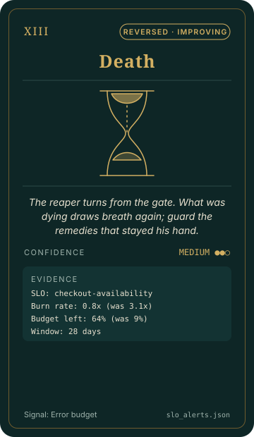
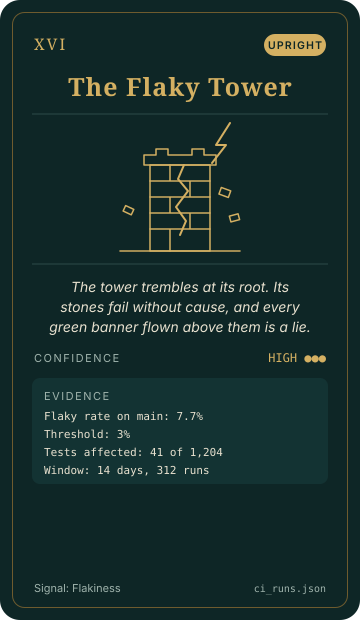
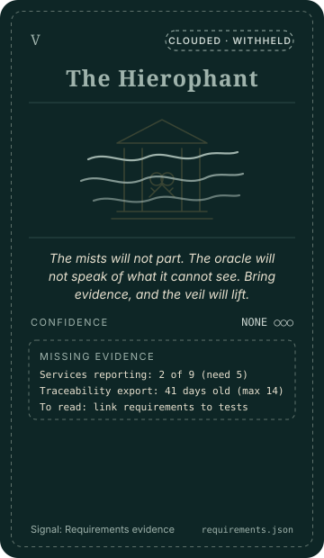

# Quality Tea Leaves

**A fortune teller for software quality that refuses to guess. Every prophecy cites its evidence; thin evidence is clouded and withheld.**

[](https://github.com/j-m-o/quality-tea-leaves/actions/workflows/ci.yml)

<p align="center">
  
  
  
</p>

> *In the past, the reaper retreats; in the present, the tower trembles; and for the next release, the road lies in mist.*

## Why this exists

AI that sounds confident without evidence is fortune telling. So this skill *is* a fortune teller, built the other way around: the theater sits on top of deterministic rules, every card shows the numbers that drew it, and a card without enough evidence is withheld instead of guessed. It turns quality signals into something people remember, without losing the numbers.

## Run the demo

Python 3.9+, standard library only, no network.

```bash
python skills/quality-tea-leaves/scripts/tealeaves.py demo --out reading
```

```
Past           XIII Death (reversed) [MEDIUM]
                    The reaper turns from the gate. What was dying draws breath again;
                    guard the remedies that stayed his hand.
                    - Burn rate: 0.8x (was 3.1x)
                    - Budget left: 64% (was 9%)
Present         XVI The Flaky Tower (upright) [HIGH]
                    The tower trembles at its root. Its stones fail without cause,
                    and every green banner flown above them is a lie.
                    - Flaky rate on main: 7.7%
                    - Tests affected: 41 of 1,204
Next Release      V The Hierophant (clouded)
                    The mists will not part. The oracle will not speak of what it
                    cannot see. Bring evidence, and the veil will lift.
                    - Services reporting: 2 of 9 (need 5)
                    - Traceability export: 41 days old (max 14)
```

Open `reading/reading.html` for the full spread and the rest of the deck. A pre-rendered copy is in [`docs/demo/`](docs/demo/reading.md).

## On every pull request

Tea Leaves reads a PR in the context of the codebase it lands in and posts **one advisory comment**, edited in place on every push. Two cards read the PR itself; the rest read the repo.

```bash
python skills/quality-tea-leaves/scripts/tealeaves.py demo-pr --out reading   # writes reading/comment.md
```

> **Next Release: 0 The Fool** (upright · confidence **HIGH** · this PR)
>
> *A traveler steps from the cliff with eyes on the sky. Changes march into the world with no test to catch their fall.*
>
> - Untested files in this PR: 1 of 2
> - File: src/cart/legacy_tax.py

See the full example comment in [`docs/demo-pr/comment.md`](docs/demo-pr/comment.md). Add it to any repo with five lines:

```yaml
- uses: j-m-o/quality-tea-leaves@v1
  with:
    required-checks: "unit-tests,integration-tests,security-scan"
    lcov: coverage.lcov        # optional
    data-dir: .tealeaves       # optional exports from mabl, Jira, Sentry, Honeycomb
```

Full workflow with permissions: [`examples/tea-leaves-pr.yml`](examples/tea-leaves-pr.yml).

**One reading, two views.** The PR comment is compact text for reviewers (comments cannot show the SVG cards). In [Claude](https://claude.ai), the same reading is published as an artifact with the full visual spread. In CI, the HTML reading is attached to the workflow run and linked from the comment. All three come from the same `reading.json`, so they never disagree.

## Where the evidence comes from

**Agents gather. Rules decide. A human approves.** Run as a skill, the agent pulls raw records through its connectors (GitHub, [mabl](https://www.mabl.com), [Jira](https://www.atlassian.com/software/jira), [Sentry](https://sentry.io), [Honeycomb](https://www.honeycomb.io) and others) into a documented data contract, with provenance for every file. It never computes a number or picks a card: the offline engine does. A contract checker sets aside malformed agent output, and the cards that needed it cloud with a reason. The comment's footer shows which system and query every number came from. Details: [gathering.md](skills/quality-tea-leaves/references/gathering.md).

| Runs as | Gathers with | Posts |
| --- | --- | --- |
| [Claude Code](https://www.anthropic.com/claude-code) or the Quality Engine, interactive | Your MCP connectors | Artifact for you; PR comment after you approve |
| GitHub Action, Lite | GitHub CLI and the workflow token, plus optional exports | One advisory PR comment |
| Claude Code GitHub Action, Full | MCP connectors with read-only tokens as secrets | One advisory PR comment |

A Jira comment or [Slack](https://slack.com) message is possible through those connectors under the same rules. It is documented, not built.

## How a card is drawn

| State | Meaning |
| --- | --- |
| **Upright** | The problem signal is present in the data |
| **Reversed** | The signal is improving (it was over threshold, now it is not) |
| **Quiet** | Nothing to read |
| **Clouded** | Source missing, sample too small or data stale. Withheld, never guessed |

Each drawn card carries a confidence level: the weaker of how big the sample is and how far the signal crosses its threshold. The three-card spread (Past, Present, Next Release) takes the strongest card in each slot. **The shuffle is theater: the same data always gives the same reading.**

## The deck (v1)

The ten cards cover the lifecycle from requirements to production.

| # | Card | Signal |
| --- | --- | --- |
| 0 | The Fool | Merges touching code no test covers |
| IV | The Emperor | Merges that bypassed required checks |
| V | The Hierophant | Requirements with no linked passing test |
| IX | The Hermit | Service borders with no integration tests |
| XII | The Hanged Man | Critical E2E tests quarantined, or E2E pass rate falling |
| XIII | Death | SLO error budget burn |
| XVI | The Flaky Tower | Main-branch runs with a flaky failure |
| XVII | The Star | Escaped defects rising or falling |
| XVIII | The Moon | Incidents found by customers before alerts |
| XX | Judgement | Overdue postmortem actions |

Rules, thresholds and confidence tiers: [card-rules.md](skills/quality-tea-leaves/references/card-rules.md). Data formats: [data-contract.md](skills/quality-tea-leaves/references/data-contract.md). Prophecy voice: [voice.md](skills/quality-tea-leaves/references/voice.md).

## Design decisions

- **Evidence or silence.** A card that cannot cite evidence is clouded. The clouded card doubles as a to-do list: it says exactly what data would let it be read.
- **Two voices, kept apart.** Prophecy is theatrical; evidence is plain and exact. The theater never touches a number.
- **Deterministic, not random.** Same data, same reading. That makes it testable and trustworthy, and it is a deliberate contrast with how most "AI insights" behave.
- **Systems, never people.** Pull request authors exist in the data; the reading never prints them, and a test enforces it.
- **Read-only, ends at a human.** Every reading is marked draft, pending human review. The skill cannot change CI, tickets, alerts or code.
- **Advisory on PRs, by design.** The comment never fails a check or blocks a merge. The one write is a single comment with a scoped token.
- **Safe on fork PRs.** Forks get a read-only token, so their reading goes to the workflow summary. It never uses `pull_request_target`, which would run untrusted PR code with write access.

## Use it on your own data

Export the JSON files described in the [data contract](skills/quality-tea-leaves/references/data-contract.md) into one folder. Every file is optional; missing sources cloud only the cards that need them.

```bash
python skills/quality-tea-leaves/scripts/tealeaves.py read --data path/to/data --out reading
```

## Tests

```bash
python -m unittest discover -s tests -v
python scripts/validate.py
```

The tests cover PR mode, the comment (marker, provenance, no author, size limit), the data contract checker, the Action's collector and poster logic, every card's state on the demo data, the spread, clouding on missing sources, thin samples and stale exports, determinism, confidence tiers, that no person is ever named, that the HTML works offline, and that the scripts make no network calls.

## Install

| Option | Use |
| --- | --- |
| `dist/quality-tea-leaves.zip` | Upload as a skill (Claude, [Agensi](https://agensi.io) or any SKILL.md agent) |
| `skills/quality-tea-leaves/` | Copy into `~/.claude/skills/` |
| `agents/quality-tea-leaves.md` | Copy into `.claude/agents/` to run it as a Claude Code agent |
| `j-m-o/quality-tea-leaves@v1` | GitHub Action for PR comments (see `examples/tea-leaves-pr.yml`) |

Build with `python scripts/build.py`. Regenerate the demo data with `python scripts/make_demo.py`.

## Roadmap

| Version | Scope |
| --- | --- |
| v1.0 | 10 cards, three-card spread, SVG line-art cards, HTML and Markdown readings |
| **v1.1** (this release) | PR mode, one advisory PR comment, GitHub Action, connector gathering guide, data contract checker, provenance |
| v1.2 | The remaining 12 Major Arcana, including The Lovers (broken contracts) and The Devil (silenced alerts) |
| v1.3 | Richer illustrated card art beyond generated line art |
| v2.0 | Minor Arcana: four suits as quality domains (Swords testing, Wands delivery, Cups customer and requirements, Pentacles operations), adding latency p95/p99 regressions, accessibility and security testing |
| Later | Tea Leaves Radio: each card drawn plays its own motif, and the reading becomes a soundtrack |

## Part of a connected portfolio

| Repo | Pattern |
| --- | --- |
| [Quality Engine](https://github.com/j-m-o/Quality-Engine) | Orchestrator + specialists |
| [Release Readiness Council](https://github.com/j-m-o/release-readiness-council) | Orchestration |
| [Control-Plane Tripwire](https://github.com/j-m-o/control-plane-tripwire) | Agent |
| [Flaky Test Investigator](https://github.com/j-m-o/flaky-test-investigator) | Subagent (its output feeds The Flaky Tower) |
| [AI Assurance Loop](https://github.com/j-m-o/ai-assurance-loop) | Loop engineering |
| **Quality Tea Leaves** | Creative: evidence-backed storytelling |

## Business value

Quality risk that people remember and act on, with every claim traceable to data. Consulting use: a keynote or workshop on evidence-based AI ("AI without evidence is fortune telling") and an entry point to AI assurance engagements.

## Limits

Reference implementation with fictional data. Thresholds are reasonable defaults, not industry standards; tune them in `assets/deck.json`. A quiet card means nothing crossed a threshold in the data provided, not that the area is healthy. The reading is only as good as the exports behind it.

See [NOTICE.md](NOTICE.md) for authorship and reuse terms.
